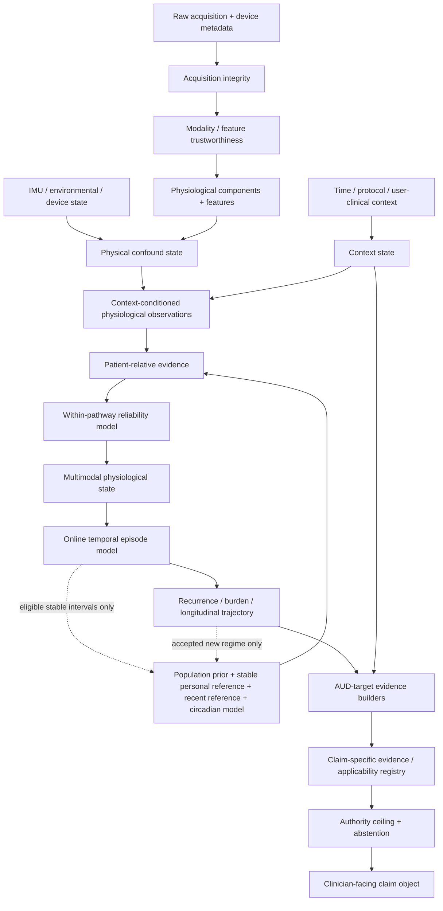

# Final End-to-End Physiological Monitoring System for AUD-Relevant Physiological Interpretation

**Status:** authoritative system design  
**Evidence cutoff:** 17 October 2026  
**Repository role:** this document supersedes layer-local architectural choices where those choices conflict with the complete-system synthesis. The underlying layer documents remain the research record and evidence source.

---

## Executive system definition

This system is a battery-powered, multimodal physiological monitoring platform that converts raw ECG, multi-wavelength/multi-distance PPG, electrodermal activity, skin and local-environment temperature, and inertial measurements into **traceable physiological evidence** and then into **claim-specific, evidence-authority-limited AUD interpretations**.

It is not a generic “stress detector,” not a single AUD classifier, and not a device that converts clean sensor data directly into diagnosis. Its central computational structure is a **stateful provenance-preserving evidence graph** with explicit permissions, uncertainty dimensions, dependency groups, temporal state, patient references, target specificity, and clinical authority ceilings.

The governing inference chain is:

```text
body state
  ↓
physical sensing + acquisition integrity
  ↓
measurement trustworthiness and feature permissions
  ↓
physiological decomposition / feature construction
  ↓
physical-confound state
  ↓
context-conditioned expectation
  ↓
patient-relative deviation
  ↓
reliability-aware physiological pathway evidence
  ↓
lag-aware multimodal physiological state
  ↓
temporal episode / recurrence / burden / trajectory
  ↓
AUD-target-specific evidence
  ↓
evidence-authority ceiling
  ↓
clinician-facing statement or explicit abstention
```

This ordering is epistemic rather than a rigid software conveyor. Context, personal references, temporal state, reliability, and acquisition state are shared state objects used by multiple inference nodes. The system is therefore a **stateful directed acyclic evidence graph with controlled feedback into reference models**, not a flat feature vector and not a strictly linear pipeline.

The completed design deliberately preserves the following non-equivalences:

```text
measurement trustworthy
≠ physiology meaningful
≠ physiology patient-abnormal
≠ physiology caused by an AUD process
≠ AUD probability validated
≠ clinical conclusion justified
≠ clinical action beneficial
```

No downstream computation may erase those boundaries.

### What the system is intended to establish

The platform can establish, when the required evidence is available:

- whether each acquired channel is usable for a specific downstream purpose;
- ECG cardiac timing and eligible NN intervals, PPG pulse timing and peripheral optical behavior, EDA tonic/phasic behavior, skin-temperature level/trend, and IMU motion/posture/tremor representations;
- whether an observed change is plausibly explained by activity, posture, recovery, respiration, thermal conditions, sensor mechanics, or another measured physical confound;
- whether the remaining physiology is unusual for the person in the current context and relative to stable, recent, circadian, and longitudinal references;
- whether independent physiological pathways agree, disagree, are missing, or are unreliable;
- whether a change constitutes an episode, sustained state, recovery, recurrence pattern, burden change, or longer trajectory;
- target-specific AUD-relevant evidence where the literature and available context support that interpretation;
- the strongest clinician-facing wording justified by measurement validity, target specificity, validation maturity, applicability, calibration, corroboration, and clinical-utility evidence.

### What the system does not infer from the present evidence base

The completed system does **not** force outputs for unsupported constructs. In particular, physiology alone does not authorize:

- AUD diagnosis;
- generic craving presence or exact craving intensity;
- exact BAC/BrAC or legal impairment;
- definitive alcohol withdrawal diagnosis;
- a full CIWA-Ar replacement;
- withdrawal seizure or delirium prediction;
- imminent relapse prediction or a numeric relapse probability;
- treatment success from HRV or any one physiological trajectory;
- specific emotion labels;
- PSG-equivalent sleep-stage pathology from wrist motion;
- reuse of AUD physiological mappings as substance-agnostic SUD mappings.

For these claims the correct system behavior is a lower-level physiological statement, `INSUFFICIENT_EVIDENCE`, `AMBIGUOUS`, `PROBABILITY_NOT_VALIDATED`, or another explicit abstention state.

---

# 1. System-wide invariants

The following are hard invariants. They are enforced in data contracts, claim rules, and authority logic rather than treated as advisory prose.

1. **Invalid measurement cannot regain authority downstream.** A later model cannot consume a measurement that the quality layer has not permitted for that use.
2. **Missing evidence is not negative evidence.** Missing ECG does not imply normal cardiac physiology; absent EDA does not argue against autonomic activation.
3. **Redundant measurements are not independent support.** ECG HR and PPG pulse rate primarily observe the same underlying cardiac timing; five HRV features from the same NN sequence do not become five votes.
4. **High-quality disagreement is preserved.** Independent high-quality pathways that disagree create `CONFLICT`/`MIXED_EVIDENCE`; they are not averaged into a reassuring scalar.
5. **Slow physiology is not automatically noise.** EDA tonic level, PPG low-frequency/perfusion behavior, temperature drift, circadian structure, and longitudinal cardiac changes remain first-class physiological quantities.
6. **Measurement artifact and confound-driven physiology are distinct.** Exercise-induced tachycardia can be genuine physiology even when it is irrelevant to an intended resting-autonomic interpretation.
7. **Context cannot be circularly manufactured.** The system may not infer “stressful event” from EDA and then use that inferred event as independent evidence explaining the same EDA.
8. **Patient-relative abnormality is not pathology.** A large robust personal deviation establishes unusualness, not cause or diagnosis.
9. **Generic autonomic activation is not AUD-specific.** Strong ECG/EDA agreement and long persistence do not manufacture withdrawal, craving, or relapse specificity.
10. **AUD association is not diagnosis.** Group-level biomarker literature cannot be silently promoted to individual diagnostic authority.
11. **High sensor quality cannot overcome weak target specificity.** Better sensors strengthen the observation, not the disease attribution.
12. **Population evidence cannot be converted into an individual probability without a validated model.** Effect sizes, p-values, AUROC, feature importance, or literature prevalence are not patient probabilities.
13. **Synthetic or surrogate data cannot establish target-device or clinical validity.** They may test algorithms, never the final clinical claim.
14. **Public/reference datasets and target-device data establish different facts.** Neither substitutes for the other.
15. **An abnormal period cannot silently become the stable personal baseline.** Baseline learning is frozen during episodes, unresolved regime shifts, device changes, and other exclusion states.
16. **Device-regime change is not patient physiology.** Sensor replacement, firmware/filter/sampling changes, electrode geometry changes, LED-drive changes, and calibration changes create a new measurement regime.
17. **Unsupported probability is never emitted because a UI wants a number.** Probability is a privileged output requiring target-, horizon-, population-, domain-, validation-, and calibration-specific evidence.
18. **Abstention is a successful final inference.** The system is complete when it correctly determines that stronger interpretation is unsupported.
19. **Public benchmark omissions do not delete useful target-hardware observables.** Dual-detector PPG and EDA contact impedance are retained when they improve the real device, but are not assigned biological meaning until characterized.
20. **Clinical action authority is separate from analytical accuracy.** Even a well-calibrated physiological model does not authorize treatment unless the surfacing/action rule has demonstrated clinical utility and safety.

---

# 2. Complete end-to-end architecture

## 2.1 The canonical stateful evidence graph



The dashed updates are tightly controlled. Event detection can **prevent** baseline adaptation; it cannot causally rewrite prior observations. A new stable physiological regime is admitted only after the change is no longer an active/censored event, the measurement regime is known, sufficient valid context coverage exists, and the candidate regime is stable.

## 2.2 Responsibility ownership

| Question | Owning subsystem | It may use | It must not do |
|---|---|---|---|
| Did the device acquire a technically usable signal? | Trustworthiness | AFE status, contact, waveform SQIs, timing, IMU as artifact witness | infer AUD or reject genuine activity physiology merely because motion exists |
| What physiological components are present? | Decomposition/feature layer | trusted waveforms | decide why physiology changed |
| Can measured physical factors explain the change? | Confound layer | IMU, posture, activity history, respiration, thermal/environment state, calibrated models | invent unidentifiable subtraction |
| What physiology is expected in this situation? | Context layer | independently observed context dimensions | infer context from the same target physiology and reuse it circularly |
| Is the observation unusual for this person? | Personalization | context-conditioned valid data, population prior, historical regimes | absorb active anomalies into normal |
| How should redundant/complementary modalities combine? | Fusion | reliability/variance, dependency groups, lags, conflicts | count correlated features as independent votes |
| Is this a persistent/recurrent trajectory rather than a window? | Temporal layer | patient-relative pathway/state evidence | assign AUD semantics |
| What AUD process is the physiology compatible with? | AUD-target layer | target-specific context, physiology, temporal evidence | use one universal AUD classifier |
| What statement may be shown to a clinician? | Authority layer | full provenance + evidence registry | exceed specificity, calibration, domain, or clinical-utility ceilings |

---

# 3. Sensing and acquisition model

## 3.1 Chosen physical architecture

The final research system uses **two battery-powered acquisition nodes**.

### Node A — chest ECG node

- **AFE:** Analog Devices MAX30005.
- **Controller:** ESP32-S3-WROOM-1-N16R8.
- **Electrodes:** disposable Ag/AgCl gel electrodes in a three-electrode modified Lead-II-like torso arrangement.
- **Placement:** measurement electrode near right upper chest/infraclavicular region, measurement electrode on left lower thorax/upper abdomen, right-leg-drive/reference electrode on right lower thorax/upper abdomen. Exact pad locations are documented in each recording and remain fixed within a study protocol.
- **Sampling:** 512 samples/s.
- **Local behavior:** sample-counter/timestamp generation at acquisition, AFE status capture, short outage ring buffer in onboard flash, wireless transfer to Node B.

The chest node is physically local to the ECG electrodes. Long body-length analog ECG traces are not used.

MAX30005 is retained because the current device is a high-input-impedance, low-noise, single-lead ECG AFE with AC/DC lead-off capability and right-leg drive, matching the intended cardiac-timing/HRV role [R1].

### Node B — wrist/finger physiological hub

- **PPG AFE:** Analog Devices MAX86173.
- **Emitter:** ams OSRAM SFH 7016: green ~530 nm, red ~655 nm, IR ~940 nm [R3].
- **Photodiodes:** 2 × Vishay VEMD8080, sensitive across visible and near-IR [R4].
- **PPG geometry:** central SFH 7016 with photodiode center-to-emitter separations of approximately **4 mm (near)** and **8 mm (far)**, with mechanical light baffles and common skin-contact pressure. The 4/8-mm geometry is selected because contemporary wrist characterization shows meaningful wavelength- and separation-dependent behavior across this range; the exact geometry remains a recorded device parameter and is characterized on the target device rather than assumed to encode a specific depth physiology [R9].
- **IMU:** TDK InvenSense ICM-42688-P, rigidly co-located with the optical interface, 200 Hz accelerometer + gyroscope [R7].
- **EDA/bioimpedance AFE:** Analog Devices AD5940 connected to same-side distal volar/palmar index and middle finger Ag/AgCl electrodes [R5].
- **Skin temperature:** TMP117 on a low-mass skin-contact island, 1 sample/s with 8-conversion averaging.
- **Local environment temperature:** a **second TMP117**, mounted environment-facing and thermally isolated from skin, battery, processor, LED and charging heat paths. It measures local wrist microclimate rather than claiming room-air temperature.
- **Controller/storage:** ESP32-S3-WROOM-1-N16R8 with 16 MB flash, 8 MB PSRAM [R8], plus 16 GB eMMC 5.x on 4-bit SDMMC at 20 MHz.

MAX86173 is retained because it provides two simultaneous low-noise optical readout channels, multiple photodiode inputs, multiple LED drive outputs and frame rates far above 200 fps, which is well matched to the dual-detector, three-wavelength architecture [R2]. VEMD8080 is explicitly suitable for visible/NIR wearable photodetection [R4].

### Why the second temperature sensor is part of the final design

A skin-contact TMP117 alone cannot distinguish a peripheral physiological temperature change from local environmental heating/cooling. The confound and context research both require that ambiguity to remain explicit. Adding a second, thermally isolated TMP117 creates a directly observed local thermal reference and a skin-minus-environment gradient. TMP117 supports 1-Hz conversion, selectable averaging, low self-heating and multiple devices on one I²C bus [R6].

This does **not** make wrist temperature a core-temperature measurement. It makes thermal confound handling scientifically stronger.

## 3.2 Optical acquisition schedule

A complete optical frame is acquired at **200 frames/s**. Each frame contains time-multiplexed illumination slots for:

```text
green LED  → near PD + far PD simultaneously
red LED    → near PD + far PD simultaneously
IR LED     → near PD + far PD simultaneously
dark/ambient slot → near PD + far PD
```

Therefore the raw optical object contains six illuminated channels plus two ambient/dark observations per frame. LED currents and AFE integration/gain are configured per wavelength so that resting DC level remains comfortably within the AFE range while pulsatile AC remains measurable. Configuration changes are not invisible housekeeping: every gain, integration-time, LED-current, averaging, or slot-schedule change increments the `measurement_regime_id`.

Automatic optical gain/current adaptation is allowed only as a **slow acquisition-control mechanism**. The system does not interpret an amplitude change across an unrecorded gain/LED-current transition as physiology.

Primary use of the wavelengths/geometries is:

- green: principal wrist pulse timing/morphology channel under ordinary perfusion;
- red/IR: complementary pulse, coupling and wavelength-consistency information;
- near/far relation: signal-quality, coupling, motion-response and spatial-consistency evidence;
- ambient/dark: ambient-light and detector-baseline evidence.

No SpO₂, tissue oxygenation, vascular “depth,” or other concentration is reported from these channels unless a separate target-device calibration/validation explicitly supports that target. The mere presence of red/IR wavelengths does not authorize oximetry [R16].

## 3.3 ECG acquisition configuration

The ECG path runs at 512 SPS. The analog/AFE configuration preserves cardiac timing and clinically useful morphology rather than aggressively removing low-frequency content before storage. The acquisition path therefore uses the lowest practical high-pass corner/bypass consistent with front-end stability and a high-frequency bandwidth sufficient for robust QRS morphology. Baseline removal for downstream cardiac timing occurs digitally on a separate feature branch.

Every ECG sample stream stores:

- AFE sample counter;
- local monotonic timestamp;
- lead-on/lead-off status;
- saturation/recovery status;
- gain/filter configuration;
- calibration/self-test state;
- continuity identifier.

The system uses ECG morphology primarily for signal quality, beat eligibility, ectopy/rhythm exclusion and timing. This AUD platform does not turn the preserved single-lead morphology into an unsupported general cardiac diagnosis engine.

## 3.4 EDA and contact-diagnostic acquisition

Continuous EDA uses constant-voltage exosomatic skin-conductance measurement at **0.5 V nominal** with same-side Ag/AgCl palmar/finger electrodes, consistent with standard electrodermal measurement recommendations [R10]. Raw conductance is sampled at 32 SPS.

The AD5940 is also used for **AC electrode/contact impedance diagnostics**, but contact impedance is not treated as EDA physiology. The two modes obey the following non-interference rule:

1. Continuous EDA is the default mode.
2. An AC contact diagnostic is run at attachment, after a suspected contact change, and at a sparse periodic cadence.
3. The diagnostic temporarily suspends/isolates the DC EDA measurement.
4. The entire diagnostic interval plus empirically determined post-switch settling interval is marked `CONTACT_DIAGNOSTIC_BLANKED` and is unavailable to EDA decomposition.
5. Contact-diagnostic frequency, excitation amplitude, duration and periodic cadence are selected on target hardware to maximize separation of controlled contact states while constraining EDA data loss and demonstrating no residual baseline shift after the blanking interval.
6. The periodic cadence is chosen under a prespecified upper blanking-duty constraint; event-triggered diagnostics may occur sooner when lead/contact evidence changes.

This makes the calibration procedure, rather than an invented universal AC frequency/duty cycle, the final parameter specification.

## 3.5 IMU acquisition

The co-located ICM-42688-P runs accelerometer and gyroscope at 200 Hz. The device supports selectable accelerometer and gyro ranges and programmable filtering [R7]. The final operating point uses an accelerometer range that does not saturate ordinary walking/arm motion while retaining tremor resolution; ±8 g is the initial configured range and ±1000 dps the gyro range. Range changes are measurement-regime changes.

The IMU serves four separate purposes:

- self-contained activity intensity and posture/orientation estimation;
- physical-confound measurement;
- motion evidence for PPG/EDA artifact attribution;
- withdrawal-relevant tremor characterization under appropriate context.

Motion does not automatically invalidate another signal.

## 3.6 Temperature acquisition

Both TMP117 sensors run at approximately 1 Hz with 8-conversion averaging. The skin sensor is mechanically isolated from processor/LED heat and pressed reproducibly to the skin; the environment-facing sensor is isolated from the skin and internal heat sources. The following are retained separately:

```text
T_skin
T_local_environment
ΔT_skin-env
thermal settling state
sensor/contact quality
```

The environment-facing channel is a local reference, not a meteorological sensor. Thermal interpretation remains conservative during rapid environment transitions.

## 3.7 Cross-node time synchronization

All samples are timestamped from the **local acquisition clock at data-ready/sample production**, never from packet arrival time.

Node B is the time master. Node A and Node B exchange timestamped synchronization messages every 10 s and after every reconnect. A robust affine clock map is maintained:

\[
t_B = a + b\,t_A
\]

where `a` captures offset and `b` captures relative drift. Only low-round-trip-time exchanges enter the fit; all exchanges, residuals and fit uncertainty are stored.

Two timing permissions are defined:

- **general multimodal fusion permission:** 95th-percentile estimated alignment error ≤20 ms;
- **beat-wise ECG–PPG timing permission:** 95th-percentile alignment error ≤5 ms and no timing discontinuity across the paired interval.

The stricter permission exists because the PPG frame period is 5 ms and ECG sampling interval is ~1.95 ms. If the strict permission fails, ECG and PPG may still support HR/pulse-rate redundancy and second-scale multimodal episodes, but pulse-arrival/transit-style features are unavailable. The core AUD architecture does not depend on pulse transit time.

Clock-mapping uncertainty is propagated as a separate timing uncertainty, never hidden inside a generic confidence score.

## 3.8 Storage and replay

Node B stores the native raw/metadata stream in eMMC. Node A retains a local ring buffer during transient wireless outage and backfills after reconnect. Every native record includes measurement-regime and software/configuration version identifiers.

Stored target-device recordings are replayable deterministically through the same scientific processing graph used online. Retrospective algorithms may refine boundaries or non-causal decompositions, but they do not change the semantic definitions of evidence objects.

## 3.9 Safety boundary

Body-connected acquisition is **battery-only**.

- USB charging, wired debugging and any galvanically connected mains-powered host are disabled while body electrodes are attached.
- Charging/data connectors are mechanically or electrically interlocked so a body-connected normal recording cannot coexist with a mains-referenced USB path.
- Routine extraction is wireless or occurs after electrode detachment.
- The design does not claim medical-device safety certification merely because individual components support medical applications; formal safety/compliance testing is a separate requirement for any regulated use.

---

# 4. Canonical data and evidence representation

The system uses typed evidence objects. A typed object can be missing or invalid without forcing the rest of the graph to invent a value.

## 4.1 Common evidence header

Every important evidence object carries:

```yaml
id:
subject_id:
measurement_regime_id:
source_device_ids: []
start_time:
end_time:
effective_time:
produced_at:
processing_mode: LIVE_CAUSAL | RETROSPECTIVE
revision:
value:
units:
availability: AVAILABLE | MISSING | UNUSABLE | NOT_READY
quality_state:
measurement_uncertainty:
feature_validity:
coverage:
timing_uncertainty:
provenance:
  parent_ids: []
  algorithm_id:
  algorithm_version:
  parameter_set_id:
reason_codes: []
```

Objects that support interpretation additionally include:

```yaml
confound_state:
context_state_ids: []
patient_reference_id:
supporting_evidence_ids: []
contradictory_evidence_ids: []
missing_required_evidence: []
model_uncertainty:
applicability_status:
evidence_maturity:
authority_ceiling:
```

## 4.2 Principal object types

### `AcquisitionBlock`
Raw samples plus sequence/timestamp/configuration/status metadata. It says what the hardware produced, not whether it is physiologically usable.

### `MeasurementValidity`
Feature-specific permission object. A PPG segment can be valid for pulse rate but invalid for morphology; an ECG segment can be valid for HR but not for HRV.

### `PhysiologicalObservation`
A physiologically named quantity such as NN interval, RMSSD, tonic EDA, SCR driver activity, PPG pulse amplitude, skin-temperature slope, activity intensity or tremor spectral power.

### `ConfoundAssessment`
For each candidate confound, stores observed state, identifiability, model domain, predicted contribution when identifiable, and action: `NONE`, `ANNOTATE`, `STRATIFY`, `NORMALIZE`, `RESIDUALIZE`, `DOWNWEIGHT`, `GATE`, or `AMBIGUOUS`.

### `ContextState`
A factorized collection of independently evidenced context dimensions. Each dimension has value, provenance, confidence/certainty, freshness and validity.

### `PersonalReference`
Population prior, stable personal regime, context-conditioned distribution, circadian expectation, recent reference and longitudinal trend. These are separate fields, not one baseline number.

### `PatientDeviation`
Observation minus expected patient/context state, with robust standardized deviation, empirical percentile where mature, absolute difference, uncertainty and baseline maturity.

### `PathwayEvidence`
Dependency-aware evidence for a physiological pathway such as cardiac timing, cardiac autonomic regulation, electrodermal activation, peripheral/thermal behavior, respiration, or tremor.

### `MultimodalPhysiologicalState`
A non-AUD physiological construct such as sustained autonomic activation. It stores which independent pathways support it, which conflict, and which are missing.

### `TemporalEpisode`
A stateful episode with candidate/onset/confirmation/active/sustained/recovering/resolved/censored states, boundary uncertainty, peak, duration, recovery and gaps.

### `LongitudinalTrajectory`
Daily/nightly burden, recurrence structure, trend and regime history.

### `AUDTargetEvidence`
One target-specific construct; never a universal AUD score.

### `ClinicalClaim`
The final claim object containing target definition, evidence maturity, reference standard, specificity, calibration, applicability, authority level, wording, abstention and surfacing policy.

## 4.3 Uncertainty is a vector, not a scalar

The system preserves at least these dimensions separately:

```text
acquisition integrity
signal quality
measurement error / observation variance
feature validity
coverage
cross-node timing uncertainty
confound identifiability
context certainty and freshness
baseline maturity
patient-reference uncertainty
model epistemic uncertainty
modality/pathway conflict
missingness
boundary/persistence uncertainty
target specificity
AUD evidence maturity
reference-standard quality
probability calibration quality
applicability-domain match
clinical authority
```

Quantities are combined mathematically only when they share a meaningful probabilistic interpretation. Quality labels, CEM grades and clinical authority are not multiplied into a pseudo-probability.

---

# 5. Signal trustworthiness and downstream permissions

## 5.1 Quality-state semantics

Per modality **and per requested feature**, the output state is:

```text
USABLE      evidence supports the requested downstream computation
DEGRADED    computation allowed but uncertainty/limitations must propagate
UNUSABLE    data present but not permitted for the requested computation
MISSING     expected data absent
NOT_READY   warm-up/contact/settling/reference state incomplete
```

A single global “sensor quality score” is not used.

## 5.2 Common acquisition-integrity gates

Before modality-specific SQIs, every stream is checked for:

- monotonic timestamps and sample counters;
- duplicate/reordered samples;
- unaccounted gaps/packet loss;
- frozen/stale data;
- clipping/saturation;
- impossible or undocumented configuration changes;
- AFE/IMU/FIFO fault status;
- cross-node timing-map validity when cross-node features are requested.

Acquisition faults create explicit missing/unusable intervals. Interpolation is never used to disguise missing raw data.

## 5.3 ECG trustworthiness

The ECG quality engine combines:

1. MAX30005 lead-on/lead-off and saturation/recovery status [R1];
2. range/flatline/clipping and baseline-noise checks;
3. two independent QRS detectors and beat-agreement SQI (bSQI-style) [R12];
4. rolling beat-template/morphology consistency using the Orphanidou family of ECG SQIs [R11];
5. spectral/baseline diagnostics;
6. beat-level eligibility and rhythm/ectopy flags.

The final permission object is feature-specific:

```yaml
permissions:
  heart_rate: true|false
  rr_intervals: true|false
  hrv_time_domain: true|false
  hrv_frequency_domain: true|false
  morphology: true|false
```

HRV requires stricter continuity and beat eligibility than heart rate. Ectopic, missed, duplicate and repaired beats are not silently treated as normal-to-normal intervals. Frequency-domain HRV is only reported over windows whose duration and stationarity support the selected measure [R19].

Abnormal but coherent cardiac physiology is not rejected merely because the rate is unusual.

## 5.4 PPG trustworthiness

PPG quality is evaluated for every wavelength × detector channel and then jointly.

Per-channel evidence includes:

- AFE/FIFO integrity and saturation;
- dark/ambient level and ambient cancellation status;
- DC level and pulsatile AC/DC (perfusion-index-like) strength;
- pulse-template correlation/morphology consistency [R11,R13];
- pulse spectral concentration/entropy;
- beat timing consistency;
- IMU-coupled degradation evidence.

Joint optical evidence adds:

- near/far pulse-time agreement;
- near/far morphology agreement after amplitude normalization;
- wavelength pulse-time consistency;
- wavelength- and distance-specific DC/AC ratios;
- changes in near/far relation during controlled contact-pressure or motion transitions.

These relationships initially strengthen **quality and coupling inference**, not biological depth claims. Target-device recordings deliberately vary pressure, placement and motion to learn their quality distributions.

Motion is never a standalone veto. High IMU motion plus preserved high-quality PPG means “motion present, PPG still usable.” High motion plus simultaneous optical quality collapse provides stronger artifact attribution.

Permissions distinguish:

```text
pulse rate
pulse timing
pulse morphology
amplitude/perfusion feature
PRV
near/far spatial feature
multi-wavelength ratio feature
ECG–PPG paired timing
```

A ratio or paired feature is unavailable if either required parent channel is invalid.

## 5.5 EDA trustworthiness

The EDA quality engine uses:

- acquisition range/floor/ceiling;
- discontinuity and derivative/slope rules adapted from transparent ambulatory EDA quality procedures [R14];
- electrode/contact diagnostic state;
- attachment transitions;
- temperature/contact plausibility;
- IMU as supporting artifact evidence;
- explicit diagnostic blanking intervals.

A large physiologically plausible SCR is not rejected simply for changing quickly. The quality decision considers waveform form, contact state and transition evidence.

The output separately records:

```text
EDA_MEASUREMENT_VALID
EDA_CONTACT_VALID
EDA_TRANSITION_MASKED
EDA_DECOMPOSITION_PERMITTED
```

Contact impedance is never fed downstream as tonic/phasic EDA physiology.

## 5.6 Temperature trustworthiness

Skin-temperature validity requires:

- fresh TMP117 conversion;
- plausible on-body/contact state;
- no digital/stuck fault;
- thermal settling after attachment;
- absence of obvious self-heating/configuration transition;
- sufficiently stable skin contact.

The environment-facing TMP117 has its own quality state. If it is missing, skin temperature can remain a valid measurement, but **environment-corrected physiological interpretation is degraded or ambiguous**.

Contact thermometry is sensitive to environment and setup; sensor accuracy alone is not equivalent to physiological accuracy [R22].

## 5.7 IMU trustworthiness

The IMU must be trustworthy before it can judge another sensor. Checks include:

- FIFO/sample continuity;
- per-axis clipping;
- stuck/frozen axes;
- configuration/range status;
- startup/self-test status;
- stationary gravity-norm consistency;
- timing integrity.

A failed IMU therefore produces `MOTION_UNKNOWN`; it does not imply “no motion.”

## 5.8 Threshold determination

Published SQI algorithms are retained, but thresholds that depend materially on device geometry, electronics, contact mechanics or placement are calibrated on target hardware. Threshold selection uses held-out subjects and explicitly penalizes **false acceptance of unusable data**, because false acceptance contaminates every later layer.

A threshold is stored with:

```text
method source
population/device used
reference annotation
operating criterion
confidence interval / uncertainty where available
version
```

---

# 6. Physiological decomposition and feature construction

All processing begins from data explicitly permitted by the quality layer. Missing/unusable intervals break continuity; downstream filters do not bridge them without recording a new segment and gap state.

## 6.1 ECG

The ECG produces two principal branches.

### Morphology-preserving branch

- retain the low-frequency cardiac waveform;
- remove baseline wander with a morphology-preserving robust/median or spline/state-space approach rather than an aggressive high-pass filter [R18 and references therein];
- preserve original raw samples alongside processed morphology.

### QRS/timing branch

- band-limit a detection copy for QRS contrast;
- detect R peaks with two independent detectors;
- reconcile detections with beat-quality evidence;
- construct RR intervals;
- label only eligible normal-to-normal intervals as NN.

Derived cardiac features include:

- instantaneous/short-window HR;
- resting HR aggregates;
- RMSSD;
- SDNN/global variability only for sufficiently long/stationary windows;
- HF/respiratory-linked measures only when recording duration, stationarity and respiration support interpretation;
- ectopy/irregularity eligibility flags.

Live filters are causal. Retrospective analysis may use zero-phase/refined baseline estimation and must emit a new revision rather than overwrite the live record.

## 6.2 PPG

For each usable optical channel the system retains distinct components:

```text
slow/DC behavior
low-frequency / respiratory-perfusion behavior
cardiac pulsatile component
residual/noise
```

A practical cardiac branch is approximately 0.5–8 Hz; slower components are preserved rather than discarded [R16]. Pulse detection uses the cardiac branch while morphology/amplitude use a branch that does not distort the pulse contour.

Per pulse/channel the system stores:

- pulse time;
- pulse interval;
- AC amplitude;
- local DC;
- AC/DC ratio;
- morphology descriptors;
- channel/wavelength/detector identity;
- quality and timing uncertainty.

The system explicitly labels pulse interval variability as **PRV**, not HRV. ECG NN-derived HRV remains authoritative when available because PRV is influenced by vascular transit and is not universally interchangeable with HRV [R20].

Near/far and wavelength relationships are retained as additional observations with their own validation state.

## 6.3 EDA

Trusted continuous EDA is copied through an anti-aliased lower-rate decomposition branch and decomposed using **cvxEDA** or an equivalent convex formulation into:

```text
tonic component
phasic component
sparse phasic driver
slow drift
residual
```

cvxEDA is selected because it explicitly models tonic/phasic structure instead of treating slow conductance as noise [R15]. The repository-supported physiological constants are used as the initial model form; device-specific resampling, block length and fixed-lag edge guard are selected by reconstruction stability and event-preservation testing on the target stream.

The raw 32-SPS EDA remains stored. No decomposition crosses a quality/contact gap.

Derived features include:

- tonic SCL and trend;
- phasic driver integral/rate;
- SCR count only under an explicitly defined detection rule;
- SCR amplitude/recovery;
- event-locked EDA response where an independent event time exists.

## 6.4 Skin/local-environment temperature

The skin temperature branch retains:

- 10-s smoothed level;
- short derivative/trend;
- local-environment temperature and trend;
- skin-minus-environment gradient;
- longer context-conditioned baseline;
- circadian component when sufficient multi-day coverage exists.

A slow skin-temperature change is retained as physiology/context evidence. It is never automatically detrended away.

## 6.5 IMU

Accelerometer + gyroscope produce:

- orientation quaternion via a gyro/accelerometer filter such as Madgwick [R21];
- gravity vector;
- gravity-removed linear acceleration;
- ENMO/vector-magnitude/activity-intensity features;
- jerk and spectral energy;
- posture/orientation state;
- tremor-band spectrum and dominant frequency;
- motion-state uncertainty.

Because no magnetometer is required, absolute yaw may drift; roll/pitch and gravity separation remain useful for posture and motion. Yaw is not used as an absolute clinical orientation.

## 6.6 Derived respiration

Respiration is estimated as an **auxiliary confound/context variable**, not a direct respiratory clinical measurement. The system combines independent respiratory modulations of ECG/PPG (e.g., amplitude/frequency/baseline modulation) over windows long enough for stable estimation [R17].

The output contains:

```text
respiratory_rate_estimate
respiratory_rhythm_regular/irregular
source_surrogates
surrogate_agreement
respiration_confidence
```

It does not claim tidal volume or replace a respiratory belt. HF-HRV/RSA interpretation is reduced or marked ambiguous when respiratory evidence is inadequate.

---

# 7. Confound-aware physiological reasoning

## 7.1 Formal distinction

For a measured physiological feature `y`, the system distinguishes:

```text
measurement artifact
real physiology caused by measured physical factors
residual physiology not explained by those factors
unidentifiable mixture
```

It never assumes a universal additive decomposition when the biology does not support one.

The confound action set is:

```text
GATE         target interpretation invalid in this state
STRATIFY     compare only within matched state
NORMALIZE    use state-specific expectation
RESIDUALIZE  subtract predicted contribution only when identifiable/calibrated
DOWNWEIGHT   retain evidence with larger uncertainty
ANNOTATE     keep physiology and label plausible contribution
AMBIGUOUS    competing explanations cannot be separated
```

## 7.2 Activity/posture state

The IMU produces both continuous activity intensity and discrete states (stationary, light movement, locomotion, posture, transition). The system also preserves lagged activity dose and post-exercise recovery state.

Activity is not merely a motion artifact variable. It changes genuine cardiac, electrodermal, thermal and vascular physiology.

## 7.3 Heart rate

At low-motion/rest conditions, patient-specific expected HR is modeled as a function of:

- activity intensity and lagged activity dose;
- posture;
- posture transition;
- local thermal state;
- time/context and recent recovery state.

A robust GAM or similarly transparent nonlinear regression is trained only from valid, non-event, physically explainable intervals. It returns a predicted physical contribution and prediction interval.

Residualization is allowed only when the current state lies within that model's calibration domain. Cycling/isometric work, unusual heat, illness-like physiology, or other unrepresented states do not receive fabricated residuals; they are `AMBIGUOUS` or gated. The need for activity adjustment in ambulatory HR interpretation is well supported [R23].

## 7.4 HRV

Resting HRV is not “corrected” by subtracting an exercise model. Instead:

- moderate/vigorous activity gates resting-HRV inference;
- early recovery gates or strongly downweights it;
- later recovery remains a distinct state until stabilization;
- posture selects a matched reference;
- HF/RSA-related interpretation is conditioned on respiration.

This protects HRV from pseudo-correction of nonlinear autonomic dynamics.

## 7.5 PPG

Pulse rate follows the cardiac activity/posture logic, but ECG is preferred for timing when available.

PPG amplitude/morphology is conditioned on:

- posture;
- activity/recovery;
- local skin/environment temperature;
- detector/wavelength geometry;
- contact/coupling state.

Strong thermal or vasoconstrictive effects are annotations/ambiguity sources; they are not blindly subtracted.

## 7.6 EDA

EDA is particularly vulnerable to non-identifiability between psychologically relevant sympathetic activation, thermoregulatory sweating and physical exertion [R24]. Therefore:

- moderate/vigorous physical activity gates non-thermal EDA interpretation;
- post-exercise recovery downweights EDA until activity, temperature and tonic conductance stabilize;
- substantial thermal change produces `THERMAL_INFLUENCE` and can cap interpretation;
- light movement with good electrodes may be retained with increased uncertainty;
- the system does **not** subtract an exercise EDA waveform and call the residual “stress.”

## 7.7 Temperature

Temperature is interpreted using `T_skin`, `T_local_environment`, their gradient, activity/recovery and PPG peripheral behavior. If environment and vasomotor explanations remain inseparable, the correct output is `AMBIGUOUS_THERMAL_OR_PERIPHERAL`.

## 7.8 Tremor

Withdrawal-relevant tremor evidence is computed only when broad voluntary motion is low enough that oscillatory content can be interpreted. Both accelerometer and gyroscope spectra are used. The literature supports alcohol-withdrawal tremor energy in approximately the 4.4–10 Hz range, with useful higher-frequency structure [R27-R30].

The final tremor estimator is calibrated against controlled/reference motion and blinded clinical tremor assessment. It returns tremor evidence and frequency/amplitude descriptors; it does not itself diagnose withdrawal.

---

# 8. Context-aware interpretation

Context establishes **what physiology is expected**, not necessarily what caused it.

## 8.1 Factorized context model

The system keeps these dimensions separate:

```yaml
sleep_rest_state:
activity_state:
posture:
circadian_phase:
known_task_or_protocol_event:
known_alcohol_cue:
known_stress_challenge:
recent_alcohol_exposure_if_independently_known:
withdrawal_risk_or_recent_cessation_context:
treatment_recovery_phase:
local_thermal_environment:
device_attachment_state:
```

Each field stores:

```text
value
certainty
provenance
observed_at
valid_until / freshness
```

`UNKNOWN` is a valid value.

## 8.2 Independent context sources

- IMU supplies activity/posture and a sleep/rest proxy;
- system clock supplies time/circadian phase;
- study protocol/event markers supply known cue or stress timing;
- user/clinician records supply recent drinking/cessation/treatment context where available;
- local environment TMP117 supplies thermal context.

An elevated EDA signal cannot create `known_stress_challenge=true`. An AUD inference cannot invent recent cessation.

## 8.3 Hierarchical fallback

Context-conditioned expectations use a hierarchy rather than a sparse Cartesian label. Example:

```text
same person + same sleep/rest + same posture + similar circadian phase
  ↓ if insufficient coverage
same person + same sleep/rest + same posture
  ↓
same person + same broad activity class
  ↓
stable personal general reference
  ↓
population prior
```

Each fallback increases patient-reference uncertainty and is recorded.

## 8.4 Sleep semantics

Wrist actigraphy can identify rest/sleep-like intervals for nocturnal cardiac summaries. It does not claim PSG sleep stage. Any target requiring sleep-stage-specific physiology is `UNEVALUABLE` unless validated sleep staging/reference data exist.

---

# 9. Personalized longitudinal physiology

The patient model answers several different questions that must not be collapsed:

```text
Is this unusual in the population?
Is it unusual for this person generally?
Is it unusual for this person in this context?
Is it unusual for this person's circadian phase?
Is it different from the recent operating level?
Is it different from the stable historical regime?
Is the long-term trajectory changing?
```

## 9.1 Reference components

For every eligible feature, maintain:

1. **Population prior/reference** — used during cold start and as shrinkage support.
2. **Stable personal reference** — robust distribution representing accepted normal regimes.
3. **Context-conditioned reference** — rest/posture/activity/sleep-conditioned distribution.
4. **Circadian expectation** — 24-h harmonic component; additional harmonics are retained only if held-out prediction improves.
5. **Recent adaptive reference** — short-horizon operating level used to detect gradual movement and distinguish acute deviation from a shifted local state.
6. **Longitudinal state/trend** — slow trajectory and accepted historical regimes.

The recent reference and stable reference have different jobs. A sustained abnormal episode may influence the recent operating level but cannot automatically rewrite stable normal.

## 9.2 Robust deviation

For mature context-matched references, a principal standardized deviation is:

\[
z_r = \frac{x - \operatorname{median}(X)}{1.4826\,\operatorname{MAD}(X)+\epsilon}
\]

with a feature-specific scale floor `ε` learned from valid population/subject data to prevent numerical inflation when MAD is near zero.

The system also retains absolute deviation and empirical percentile. A large `|z_r|` is statistical abnormality, not clinical severity.

## 9.3 Baseline maturity

Maturity is a vector based on:

- number of valid independent windows/days;
- context coverage;
- circadian coverage;
- stability;
- recency;
- measurement-regime continuity;
- effective sample independence.

Elapsed time alone cannot make a baseline mature. Until maturity is adequate, the estimate is shrunk toward the population prior and patient-relative authority is capped.

## 9.4 Baseline update eligibility

Stable baseline learning is frozen during:

- `UNUSABLE`/substantially degraded data;
- unresolved confound;
- uncertain critical context;
- active/sustained/recovering physiological episodes;
- candidate change points;
- withdrawal/treatment/exposure transitions that intentionally define a different regime;
- device/sensor/firmware/filter/electrode/optical-regime change;
- long data gaps.

This prevents pathology or instrumentation changes from becoming “normal.”

## 9.5 Regime change

A persistent change point creates a **candidate regime**, not an immediate baseline update. A new stable regime is accepted only when:

- the episode lifecycle no longer classifies the interval as unresolved acute physiology;
- no device-regime change explains it;
- enough valid context-matched evidence has accumulated;
- the candidate distribution is internally stable;
- the regime transition is explicitly retained in history.

Old regimes are not deleted.

---

# 10. Reliability-aware multimodal physiological reasoning

## 10.1 Dependency groups

Signals are grouped by what they actually observe.

### Cardiac timing

- ECG R-R timing: primary;
- PPG pulse timing: redundant/fallback observation of the same cardiac cycle with vascular delay.

### Cardiac autonomic regulation

- ECG NN-based HRV: primary;
- PPG PRV: related but not treated as equivalent unless the exact feature/state is validated [R20].

### Electrodermal pathway

- tonic/phasic EDA.

### Peripheral optical/vascular pathway

- PPG amplitude/morphology/perfusion relations after thermal/posture conditioning.

### Thermal pathway

- skin level/gradient/trend.

### Motion/tremor pathway

- IMU physical activity/posture/tremor.

### Respiration auxiliary pathway

- derived respiratory estimate; dependency on parent ECG/PPG is retained.

Context is not an independent physiological vote.

## 10.2 Within-pathway fusion

When two sensors measure the same latent quantity, use a quality-dependent state-space/inverse-variance formulation rather than vote counting. Observation variance is calibrated against reference error where possible.

For a latent quantity `x_t` with observations `y_i,t`:

\[
y_{i,t}=x_t+\varepsilon_{i,t},\qquad
\varepsilon_{i,t}\sim\mathcal{N}(0,R_{i,t})
\]

`R_i,t` is allowed to depend on signal quality, contact, activity and device regime.

If high-quality ECG and PPG timing disagree beyond the validated relation, the system does not drive `R` upward until conflict disappears. It emits a **conflict state**, preserves each observation and suspends derived paired features until the conflict is explained.

## 10.3 Complementary pathway fusion

Higher physiological states are target-specific. A transparent physiological-state model consumes pathway evidence, uncertainty, conflicts, context and temporal alignment. It can be a calibrated multivariable probabilistic model when enough data exist, but it is never a generic multiplication of “confidence scores.”

A strong label such as `MULTIMODAL_AUTONOMIC_ACTIVATION` ordinarily requires at least two physiologically distinct supporting pathways (for example cardiac + electrodermal) and no unresolved dominant physical explanation. One pathway can still produce a pathway-specific claim.

## 10.4 Latency

Pathways have different physiological response times. The evidence graph stores each observation's effective interval and target-specific lag model. Event-locked EDA may lag a cue by seconds, while temperature is slower. The fusion engine aligns by physiologically justified lag distributions rather than requiring same-window peaks.

Cross-modal lag parameters are estimated from synchronized target-device and reference data; one universal lag is not imposed.

## 10.5 Missingness

The states are distinct:

```text
MISSING       no observation
UNRELIABLE    observation exists but cannot be trusted
NEUTRAL       valid evidence near expected state
CONTRADICTORY valid evidence opposes a hypothesis
UNSUPPORTED   this modality has no validated relation to this claim
```

Population-normal imputation is prohibited for making a target computable.

---

# 11. Temporal physiological episode and trajectory model

The temporal model converts valid patient-relative evidence into events without assigning AUD semantics.

## 11.1 Hierarchy

```text
WINDOW / OBSERVATION
    ↓
MODALITY OR PATHWAY EVENT
    ↓
MULTIMODAL PHYSIOLOGICAL EPISODE
    ↓
RECURRENCE GROUP
    ↓
DAILY / NIGHTLY BURDEN
    ↓
LONGITUDINAL TRAJECTORY
```

## 11.2 Online change proposal

Use **Bayesian Online Changepoint Detection (BOCPD)** [R25] on robust patient-relative pathway/state features to propose changes. The hazard/prior and observation model are feature/state-specific and calibrated on held-out data rather than fixed universally.

A simpler CUSUM/Page-Hinkley statistic may run as a diagnostic companion, but BOCPD is the canonical online proposal mechanism because it explicitly represents change-point uncertainty.

## 11.3 Explicit lifecycle

Every episode follows an interpretable state machine:

```text
BASELINE
  → CANDIDATE
  → ACTIVE_CONFIRMED
  → SUSTAINED
  → RECOVERING
  → RESOLVED
```

At any point the evidence can become:

```text
UNKNOWN_DATA_GAP
CENSORED
CONFLICTING
```

`RECOVERING` is first-class. Resolution requires observed recovery evidence; a long missing interval is never called recovery.

## 11.4 Persistence and hysteresis

Entry/exit thresholds, confirmation duration and recovery criteria are selected for each physiological construct using held-out subject/event data with an explicit operating objective such as:

```text
minimize onset delay
subject to false physiological episodes/day ≤ prespecified tolerance
and acceptable duration/boundary error
```

The result is a complete parameter rule without inventing a universal `0.72` threshold.

## 11.5 Gaps and censoring

A short gap may bridge an episode only if the target-specific maximum gap rule is satisfied and uncertainty is propagated. A longer gap censors the episode:

```text
active before gap + missing after gap
≠ recovered
```

Boundary uncertainty includes the gap.

## 11.6 Recovery metrics

For each episode, store:

- recovery start;
- peak-to-baseline fractional recovery;
- time to 50% and 80% recovery where observable;
- recovery slope/nonparametric area;
- interrupted recovery;
- unresolved/censored recovery.

An exponential recovery constant is fitted only when the data support that model; it is not assumed.

## 11.7 Recurrence and burden

Episodes belong to one recurrence group only when morphology, duration, recovery and context are sufficiently similar under a calibrated similarity model. Burden is computed at the parent-episode level to avoid counting every 30-s child window as a new event.

Nightly/daily summaries include episode count, duration, integrated deviation, recovery impairment and censored coverage. Longitudinal trend models operate on these summaries with explicit coverage.

## 11.8 Retrospective refinement

Stored recordings undergo a retrospective **PELT** change-point pass [R26] and non-causal feature/decomposition refinement where justified. Retrospective analysis may adjust onset/offset and merge/split decisions but creates a new episode revision with links to the live version.

Future samples are never used in the original live decision.

---

# 12. AUD-specific physiological inference

AUD semantics enter only after measurement validity, decomposition, physical-confound handling, context, personalization, pathway reconciliation and temporal support are available.

There is **no universal `AUD_classifier`**. Each target has its own evidence contract.

## 12.1 Withdrawal-related physiological activation

**Construct:** persistent autonomic activation compatible with alcohol withdrawal in an independently established withdrawal-risk/recent-cessation context.

**Required context:** withdrawal-risk/recent reduction/cessation or active detox/withdrawal context from history/clinical workflow. Physiology cannot infer this prerequisite.

**Primary evidence:**

- resting/confound-resolved HR elevation relative to personal/context reference;
- EDA activation when activity/thermal effects do not dominate;
- temporal persistence.

**Supporting evidence:**

- HRV/autonomic dysregulation where valid;
- peripheral/temperature behavior;
- separately estimated tremor;
- repeated worsening trajectory.

**Contradictions/limiters:**

- intense activity/recovery;
- infection/pain/anxiety/medication or other known plausible causes;
- absent withdrawal context;
- high-quality pathway conflict;
- immature personal reference.

**Output:** `withdrawal_related_physiological_activation` with `SUPPORTED`, `WEAK`, `MIXED`, `INSUFFICIENT`, or `NOT_EVALUATED` evidence state and trend.

The literature supports autonomic abnormalities during acute withdrawal but not a physiology-only wearable diagnosis [R27,R28]. Current maximum generic authority is therefore **A4 compatibility**, not diagnosis or probability.

## 12.2 Withdrawal tremor evidence

**Construct:** oscillatory limb motion consistent with the tremor component observed in alcohol withdrawal.

**Inputs:** 200-Hz accelerometer/gyro, stationary/low-voluntary-motion state, spectrum and harmonic shape, repeated segments.

**Method:** estimate 4.4–10 Hz energy, dominant frequency, narrow-band prominence relative to neighboring spectrum, axis coherence and gyro/accel agreement; classify/score only using a target-device model calibrated against blinded tremor reference ratings [R29,R30].

**Output without AUD context:** A3 `TREMOR_PATTERN_PRESENT`.

**With withdrawal context:** tremor may support A4 withdrawal compatibility. It never reconstructs a full CIWA-Ar score by itself.

## 12.3 Known alcohol-cue autonomic reactivity

**Required context:** cue onset/offset is independently known.

**Method:**

1. establish a valid pre-cue patient baseline;
2. form a multivariate response vector from HR/HRV, EDA and optional peripheral/temperature observations;
3. account for physical activity/posture and known non-cue events;
4. measure response magnitude, latency and recovery;
5. when neutral-control cues exist, compute alcohol-minus-neutral differential;
6. compare with the person's previous cue-response distribution.

**Output:** `alcohol_cue_autonomic_reactivity`.

The system may say that an autonomic response occurred during a known alcohol cue and is compatible with cue reactivity. It may not infer subjective craving intensity from physiology alone. Naturalistic physiology–craving relationships are heterogeneous [R34,R35].

## 12.4 AUD-relevant stress reactivity

**Required context:** independently known stress challenge/event plus AUD/recovery context.

**Method:** event-locked magnitude and recovery versus the subject's historical response to comparable stress contexts.

**Output:** `aud_relevant_stress_reactivity`, primarily an A3 physiological response with A4 AUD-association wording only where the evidence registry supports the exact setting.

Generic arousal outside known stress context is not relabeled “AUD stress.”

## 12.5 Alcohol-associated impairment pattern

This is a narrow supervised target, not BAC estimation.

**Reference truth:** contemporaneous BrAC/BAC and/or a precisely defined validated impairment endpoint.

**Inputs:** target-device IMU + HR + EDA + temperature/peripheral features, personal sober reference, context and quality.

**Model:** a subject-independent multimodal classifier may be used only after it is trained/evaluated with participant-grouped splits and then externally validated on the intended device/population. A small 2026 controlled study supports feasibility of wearable impairment classification but not general deployment calibration [R36].

**Current system behavior:** absent external target-device validation/calibration, the output is at most a research A4 similarity/association statement or `PROBABILITY_NOT_VALIDATED`. It never reports exact BAC or legal fitness.

## 12.6 Chronic autonomic dysregulation burden

**Construct:** persistent patient-relative reduction/change in stable resting/nocturnal cardiac autonomic indices.

**Inputs:** quality-approved resting/nightly ECG HR and HRV, context/coverage, multiple days.

**Method:** robust nightly/rest medians and dispersion; exclude acute challenge/event intervals; compare stable personal trajectory and population reference separately.

**Output:** `autonomic_dysregulation_burden` and trend.

Reduced HRV is associated with AUD at group level but is heterogeneous and nonspecific [R31]. Patient-level output is therefore primarily A3; an A4 literature association annotation may be shown without implying AUD diagnosis.

## 12.7 Autonomic recovery / abstinence progression

**Required context:** known treatment/recovery/abstinence timeline.

**Inputs:** resting/nocturnal HR and ECG-HRV over weeks, early-recovery reference, stable personal history.

**Method:** robust longitudinal state-space/trend model over valid nightly/rest summaries; separate transient bad nights from sustained trajectory movement.

**Output:** `autonomic_recovery_trend`.

Longitudinal studies support partial autonomic recovery with abstinence, but HRV is not a validated surrogate for treatment success [R33].

## 12.8 Nocturnal autonomic recovery state

**Construct:** patient-relative nocturnal elevation in HR and/or suppression of parasympathetic HRV with altered recovery pattern.

**Inputs:** sleep/rest proxy, first-hours and whole-night cardiac summaries, coverage, personal alcohol-free/reference nights, known recent exposure when available.

**Method:** compare night-level state against context/circadian personal distribution and aggregate across repeated nights. Acute alcohol can suppress nocturnal autonomic recovery [R32].

**Without independent alcohol exposure context:** output A3 `NOCTURNAL_AUTONOMIC_RECOVERY_DISTURBANCE`.

**With an appropriate known exposure:** an A4 alcohol-associated compatibility statement may be added. The system still does not estimate BAC.

## 12.9 Treatment-associated physiological change

**Required context:** known intervention and timing.

**Method:** compare pre/post and recovery trajectories with context/coverage control and event exclusions.

**Output:** `treatment_associated_physiological_change`.

It reports a physiological trajectory associated in time with treatment; it does not say “treatment works” unless a separately validated surrogate/clinical outcome model exists.

## 12.10 Relapse-risk-associated physiological deviation

**Construct:** multi-day deterioration in features previously associated with relapse/recovery outcomes, not a relapse predictor.

**Inputs:** 3–7-day cardiac/autonomic deviation, nocturnal recovery trajectory, optional known cue-reactivity phenotype, recovery-stage context.

**Output:** `relapse_risk_associated_physiological_deviation` with literature evidence grade and explicit `posterior_probability: NOT_ESTIMATED` under the current evidence base.

Prospective associations exist in selected cohorts but do not establish a generally calibrated ambulatory relapse probability [R34,R35].

## 12.11 Explicitly prohibited target substitutions

```text
cue reactivity ≠ craving
nonspecific autonomic activation ≠ withdrawal
wearable impairment pattern ≠ BAC
low HRV ≠ AUD diagnosis
sleep disturbance ≠ relapse
physiological improvement ≠ treatment efficacy
```

---

# 13. Evidence-authority-aware clinical interpretation

The final layer answers one question:

> **What is the strongest clinician-facing statement justified by this exact claim's evidence?**

## 13.1 Claim Evidence Maturity (CEM)

The system uses a claim-specific evidence maturity scale:

| CEM | Evidence achieved for the exact target | Default authority implication |
|---|---|---|
| CEM-0 | mechanistic plausibility only | no patient-level AUD claim |
| CEM-1 | replicated group association | association background only |
| CEM-2 | within-person/longitudinal association or replicated state-linked change | cautious compatibility; no validated probability |
| CEM-3 | individual discrimination/prediction with proper subject-independent validation and defined reference | cautious model-based interpretation in matched setting |
| CEM-4 | independent external validation + calibration in intended population | calibrated probability may be allowed |
| CEM-5 | prospective workflow evaluation and demonstrated net clinical benefit/safety | action-oriented CDS may be allowed within scope |

CEM is stored with risk of bias, reference-standard grade, replication, literature consistency and applicability; it is not a regulatory label [R40-R44].

## 13.2 Reference-standard grades

```text
RS-A  adjudicated/validated clinical endpoint with appropriate objective data
RS-B  validated clinical scale or structured assessment within supported use
RS-C  well-defined EMA/self-report or controlled laboratory state
RS-D  retrospective/heuristic proxy
RS-E  ambiguous derived label; insufficient for high authority
```

A model can only inherit the meaning of its target label.

## 13.3 Authority classes

| Level | Permitted meaning | Example |
|---|---|---|
| **A0 — ABSTAIN** | higher-level interpretation unsupported | “AUD-specific interpretation not supported.” |
| **A1 — MEASUREMENT** | reliable measurement | “Resting HR is 92 bpm.” |
| **A2 — PATIENT-RELATIVE FEATURE** | validated personal deviation | “Resting HR is elevated relative to established baseline.” |
| **A3 — PHYSIOLOGICAL STATE** | supported physiological construct | “Sustained multimodal autonomic activation is present.” |
| **A4 — AUD COMPATIBILITY/ASSOCIATION** | cautious relation to AUD target | “In the current withdrawal context, the pattern is compatible with withdrawal-related autonomic activation, but is not diagnostically specific.” |
| **A5 — CALIBRATED AUD PROBABILITY/RISK** | validated probability for an exact target/horizon | enabled only claim by claim after CEM-4 conditions |
| **A6 — CLINICIAN-REVIEW CDS** | validated recommendation to review/reassess | only under a consequence-sensitive validated protocol |
| **A7 — ACTION RECOMMENDATION** | action within prospectively validated protocol | unavailable generically for the current physiology-only AUD evidence base |

## 13.4 Authority ceiling

For claim `c` at time `t`:

\[
A_{max}(c,t) = \min\{
A_{upstream},A_{association},A_{specificity},A_{validation},
A_{reference},A_{domain},A_{calibration},A_{corroboration},A_{utility}
\}
\]

The `min` is a conceptual hard-ceiling operator, not a claim that all terms are continuous numbers.

Soft support such as persistence, independent pathways, mature personal baseline and corroboration may strengthen a claim **within** `A_max`. It cannot cross the ceiling.

## 13.5 Hard gates

A higher claim is capped or blocked when:

1. required upstream evidence is invalid;
2. a dominant confound remains unresolved;
3. claim-essential context is missing;
4. no defensible clinical association exists;
5. the current patient/setting/sensor/horizon is outside the validated domain;
6. a numeric probability is requested without adequate external calibration;
7. an action/review recommendation lacks demonstrated utility for the intended workflow.

Lower-level physiology may remain valid when the higher claim abstains.

## 13.6 Probability privilege

A clinician-facing numerical probability is permitted only when all are true:

- exact target is defined;
- prediction horizon is defined;
- intended population/setting is defined;
- reference standard is defensible;
- subject-independent development validation exists;
- independent external or temporally independent validation exists;
- calibration is acceptable in the intended population;
- current case is in-domain;
- uncertainty is represented appropriately.

Calibration is distinct from discrimination [R42]. A raw classifier score is never rendered as a clinical probability.

## 13.7 Applicability and OOD

Each claim/model stores:

```text
validated population
setting
target definition
prediction horizon
sensor configuration / feature pipeline
required inputs
critical exclusions
medication/treatment constraints where known
reference standard
```

Applicability is assessed in three layers:

1. explicit domain rules;
2. distribution/missingness/feature-shift monitoring;
3. model uncertainty/reject behavior.

A critical domain mismatch produces `OUT_OF_DOMAIN` for that model-based claim.

## 13.8 Abstention states

```text
INSUFFICIENT_EVIDENCE
AMBIGUOUS
MIXED_EVIDENCE
OUT_OF_DOMAIN
OUT_OF_DISTRIBUTION
CLINICAL_INTERPRETATION_NOT_SUPPORTED
PROBABILITY_NOT_VALIDATED
```

These states are claim-specific. An episode may simultaneously be:

```yaml
physiological_state: SUPPORTED
withdrawal_compatibility: AMBIGUOUS
relapse_probability: PROBABILITY_NOT_VALIDATED
```

## 13.9 Surfacing is separate from truth

The system has independent surfacing tiers:

```text
S0  store/background
S1  trend highlight
S2  clinician attention flag
S3  clinician review notification
S4  urgent protocol escalation
```

A4 does not automatically trigger S2/S3. Review/urgent surfacing requires a validated consequence-sensitive policy, not merely a high physiological score. Decision-curve analysis is appropriate only once a valid target probability and intended action exist [R45].

Repeated windows update one episode; they do not spam repeated alerts.

---

# 14. Missingness, conflict and negative evidence

## 14.1 Missing evidence

For every target, required and optional inputs are registered. If a required primary input is absent, the target becomes `UNEVALUABLE`/`INSUFFICIENT_EVIDENCE` rather than being filled with population-normal physiology.

Examples:

- ECG missing, PPG good: pulse rate remains available; ECG HRV is unavailable; PRV is not silently relabeled HRV.
- EDA missing: cardiac/autonomic evidence may remain, but any target requiring independent electrodermal support loses that support.
- IMU missing: activity/posture confound becomes unknown; resting-autonomic attribution may be capped.
- local environment temperature missing: skin temperature is measurable but thermal attribution is weakened.
- context unknown: target requiring that context abstains.

## 14.2 Conflict

High-quality conflict is stored as:

```yaml
supporting_evidence: []
contradictory_evidence: []
conflict_state:
conflict_magnitude:
```

The system may produce `MIXED_EVIDENCE` even when every contributing sensor is individually high quality.

## 14.3 Negative evidence

Absence of a marker is negative evidence only if the marker has validated sensitivity for the exact target and current conditions. Normal EDA does not “rule out craving”; absent tremor does not rule out withdrawal.

---

# 15. Online and retrospective processing semantics

## 15.1 Live causal mode

Live mode uses only present/past information:

- causal filtering/decomposition;
- current context/confound state;
- current personal references frozen according to eligibility rules;
- online BOCPD proposals;
- lifecycle/hysteresis;
- current target evidence and authority.

Every live claim stores the evidence snapshot and algorithm/version that existed at that time.

## 15.2 Retrospective mode

Retrospective replay may use:

- zero-phase/refined waveform processing;
- long-segment EDA decomposition;
- better gap characterization;
- PELT boundary refinement;
- event merge/split reconciliation;
- complete-day/night circadian and burden summaries.

If it revises an episode, it creates `revision=n+1` and retains the live claim. It never retroactively pretends future data were available online.

---

# 16. Data and evidence foundation

The scientific design uses **independent public/reference data and native target-hardware data together**.

## 16.1 What each source establishes

| Component | Independent/public/reference evidence establishes | Target-hardware evidence establishes | Neither alone establishes |
|---|---|---|---|
| ECG/PPG/EDA SQI | general signal-quality principles, benchmark methods | actual failure signatures, geometry/contact thresholds, observation variance | AUD clinical utility |
| Decomposition | established physiology and algorithms | translation to this sampling/AFE/placement | AUD specificity |
| PPG near/far/wavelength relations | optical plausibility and prior geometry evidence | actual 4/8-mm, SFH7016/VEMD8080 information content | unvalidated depth/oxygen meaning |
| EDA impedance diagnostic | bioimpedance/contact capability | relation between impedance and EDA quality on this electrode setup | psychological state |
| Confound models | known activity/posture/respiratory/thermal effects | device- and person-specific quantitative relation | perfect causal separation when factors are unobserved |
| Personalization | population priors and expected variability | the individual's context/circadian distributions | diagnosis |
| Multimodal fusion | dependency principles and reference models | native covariance, failure correlation, cross-modal lags | target specificity by sensor agreement alone |
| Temporal model | change/event algorithms | false-event behavior and episode boundaries on native data | AUD semantics without labels/context |
| AUD targets | published clinical/AUD association and outcome evidence | whether target features survive this device | broad external clinical validity without appropriate AUD cohort/reference |
| Clinical authority | validation/calibration/CDS methodology | local system performance | clinical benefit without prospective evidence |

## 16.2 Target-hardware characterization is part of the final science

Native recordings characterize:

- ADC/sensor noise, saturation and dynamic range;
- warm-up/settling;
- timing jitter and inter-node drift;
- packet loss/buffering;
- ECG electrode/contact behavior;
- wavelength- and detector-distance behavior;
- motion-to-optical contamination transfer;
- EDA contact-impedance/quality relation;
- skin/local-environment thermal response;
- subject/device interactions;
- modality-specific observation variance;
- cross-modal latency under known challenges.

Controlled acquisition degradation is labeled as **measurement degradation**, not abnormal physiology.

## 16.3 Public/reference dataset role

Independent datasets remain necessary for:

- external physiological reference;
- algorithm benchmarking across hardware;
- subject-independent testing;
- clinical/AUD cohorts and outcomes not practical to reproduce locally;
- protection against overfitting the entire scientific story to one prototype.

WESAD and other multimodal datasets can benchmark stress/confound machinery, for example, but they cannot validate AUD inference or target-device equivalence.

---

# 17. Ground truth and reference standards

Every inferred target has an explicit reference.

| Target | Reference truth |
|---|---|
| signal quality | expert/reference waveform annotation + controlled corruption/contact protocol |
| ECG R peaks/HR | high-quality reference ECG/expert beat annotation |
| PPG pulse timing | ECG cardiac timing plus manual/reference pulse annotation where needed |
| HRV | eligible NN intervals from trusted ECG |
| activity/posture | controlled protocol labels / direct observation |
| tremor | reference accelerometry/controlled motion + blinded clinical tremor component rating |
| EDA feature response | controlled stimulus timing and expert artifact/contact annotation; subjective state remains a separate construct |
| skin temperature | calibrated reference thermometry + controlled environment/contact protocol |
| sleep stage | PSG if ever claimed; wrist actigraphy alone is not the reference |
| known alcohol cue | independently controlled cue timing |
| subjective craving | contemporaneous EMA/self-report |
| alcohol exposure/intoxication target | BrAC/BAC/documented consumption appropriate to target |
| withdrawal | clinician assessment / validated structured scale / adjudicated clinical state appropriate to intended use |
| relapse | prespecified confirmed drinking outcome and exact horizon |
| treatment outcome | clinically defined outcome, not HRV change itself |

A proxy is always named as a proxy. The system never trains on one construct and writes as though it learned another.

---

# 18. Calibration and evaluation semantics intrinsic to the system

These rules determine whether an evidence object is allowed to exist at a given authority; they are therefore part of the final system, not a roadmap.

## 18.1 Leakage prevention

For claims intended to generalize across people:

- split by participant, not random windows;
- keep overlapping/adjacent windows from one episode in one partition;
- fit preprocessing/baselines on training data only;
- use held-out participants for threshold/model calibration;
- use independent external cohorts for CEM-4 probability claims.

For personalized within-person claims:

- historical data must precede the evaluated future interval;
- the future episode cannot leak into its own baseline;
- chronological evaluation is mandatory.

## 18.2 Evaluation unit must match the claim

- beat claims: beat-level error;
- feature claims: feature/reference error and coverage;
- episode claims: event sensitivity, false events/day, onset/offset error, duration/recovery error;
- burden claims: day/night-level error;
- risk claims: patient/outcome-level discrimination, calibration and decision utility.

Window accuracy alone cannot validate an episode or patient-risk claim.

## 18.3 Calibration

A probability-capable model reports, as appropriate:

- calibration curve;
- calibration intercept/slope;
- Brier/proper score;
- discrimination separately;
- uncertainty intervals;
- subgroup/setting performance;
- coverage/reject behavior.

Recalibration cannot repair a bad label, target mismatch or weak clinical association.

---

# 19. Consolidated parameter and evidence provenance

| Parameter/family | Final value/rule | Provenance class |
|---|---|---|
| ECG sampling | 512 SPS | engineering operating point supported by AFE architecture/current design |
| PPG frame rate | 200 full optical frames/s | engineering operating point within MAX86173 capability [R2] |
| PPG wavelengths | ~530/655/940 nm | emitter hardware [R3] |
| PPG separations | ~4 mm near, ~8 mm far | external optical evidence + target-device characterization [R9] |
| EDA sampling | 32 SPS | engineering operating point |
| EDA DC excitation | 0.5 V nominal | literature-supported EDA methodology [R10] |
| EDA contact diagnostic | event-triggered + sparse periodic; parameters chosen by contact-separation performance and bounded blanking duty | target-device empirical |
| skin/environment temperature | ~1 SPS, 8-conversion averaging | TMP117 operating point [R6] |
| IMU | 200 Hz accel+gyro; initial ±8 g/±1000 dps | engineering operating point within ICM-42688-P capabilities [R7] |
| general cross-node timing permission | 95% error ≤20 ms | engineering requirement from downstream multimodal timing |
| ECG–PPG beat-pair permission | 95% error ≤5 ms | engineering requirement derived from source sample/frame periods |
| robust personal standardization | median / 1.4826 MAD + scale floor | mathematical/robust-statistical |
| context/circadian reference | hierarchical robust reference; 24-h harmonic if coverage supports | population/patient adaptive |
| quality thresholds | held-out target-device calibration against reference annotation | empirical device-specific |
| confound model coefficients | valid non-event target-device/personal data; domain-limited | patient/device empirical |
| fusion observation variance | reference prediction error conditioned on quality/context | empirical |
| BOCPD hazard/observation model | event-level held-out calibration | empirical temporal |
| event entry/exit/persistence | chosen to control false events/day and boundary delay for each construct | empirical target-specific |
| AUD target model thresholds | exact target/reference/participant-level calibration only | clinical/empirical target-specific |
| CEM and authority ceiling | evidence registry review | scientific/clinical evidence provenance |

No unexplained magic constants are allowed in a released parameter set.

---

# 20. Hardware-change justification

| Current candidate | Final change | System requirement | Information/robustness gained | Cost/complexity | Status |
|---|---|---|---|---|---|
| one central controller implied | two ESP32-S3 acquisition nodes: chest ECG + wrist/finger hub | keep sensitive AFE local to body interface without long analog runs; preserve wearable geometry | lower analog susceptibility; independent chest buffering; explicit synchronization model | second MCU/battery/power domain + clock sync | **essential to chosen physical architecture** |
| one TMP117 skin sensor | add second TMP117 environment-facing | distinguish local thermal exposure from skin physiological change | skin-environment gradient; better temperature/EDA/PPG confound reasoning | small BOM/PCB/mechanical increase | **materially beneficial; required for high-authority thermal interpretation** |
| unspecified dual-PD geometry | fix initial center separations near≈4 mm, far≈8 mm with baffles | exploit spatial redundancy without arbitrary geometry | near/far coupling and motion-quality information; wavelength-distance characterization | mechanical layout constraint | **materially beneficial** |
| one global timebase not physically available across nodes | explicit two-way clock mapping and timing permissions | synchronized multimodal analysis | bounded timing uncertainty and graceful disabling of beat-pair features | firmware/metadata complexity | **essential** |

No sensor is added merely to manufacture novelty. No transdermal alcohol sensor, respiratory belt or research-grade clinical instrument is added to the wearable core. When a higher-specificity reference such as BrAC/BAC or PSG is needed for a study/claim, it is a reference-standard measurement, not silently substituted by wearable physiology.

---

# 21. End-to-end worked scenarios

## Case A — genuine autonomic change at rest

**Observed:** ECG, PPG and EDA are technically high quality; motion is minimal; posture stable; HR is elevated, RMSSD reduced and EDA phasic/tonic activity increased relative to a mature rest baseline.

**Flow:**

1. Acquisition integrity passes; all relevant feature permissions are granted.
2. ECG produces eligible NN intervals; PPG agrees on pulse timing but is treated as redundant cardiac timing support rather than a second cardiac vote.
3. EDA decomposition yields increased tonic/phasic evidence.
4. IMU/posture/recovery state provides no dominant physical explanation; local thermal reference is stable.
5. Context selects resting, posture- and circadian-matched personal references.
6. Patient deviations are strong in cardiac and electrodermal pathways.
7. Fusion finds two independent pathways concordant: `MULTIMODAL_AUTONOMIC_ACTIVATION`.
8. BOCPD/lifecycle confirms persistence and later observes recovery.
9. If no AUD-specific context exists, AUD targets requiring such context abstain.

**Final:** A3 — “Sustained multimodal autonomic activation is present relative to the patient's resting baseline.” No withdrawal/craving/relapse claim is made.

## Case B — activity-driven physiology

**Observed:** similar HR/EDA elevations, but IMU shows sustained locomotion followed by recovery.

**Flow:**

1. ECG/EDA may remain technically excellent; the physiology is real.
2. Activity/posture model predicts a substantial HR response; resting-HRV interpretation is gated.
3. EDA is gated/downweighted for non-thermal autonomic interpretation during exertion/recovery.
4. The system records `PHYSICAL_ACTIVITY_EXPLAINS_SUBSTANTIAL_COMPONENT` rather than `artifact`.
5. A resting autonomic episode is not created unless a residual/persistent change remains after calibrated recovery.

**Final:** “Cardiac and electrodermal activation occurred during physical activity; evidence is insufficient for a resting autonomic episode.” This differs from Case A even though the raw physiology is similar.

## Case C — corrupted PPG, clean ECG

**Observed:** wrist optical channel saturates/loses pulse morphology during poor contact; ECG remains clean.

**Flow:**

1. PPG quality becomes `UNUSABLE` for pulse morphology/timing; IMU/contact evidence provides artifact attribution.
2. ECG retains HR/RR/HRV permissions.
3. Cardiac timing pathway uses ECG; no population-normal PPG is imputed.
4. ECG and PPG are not “averaged.”
5. Peripheral optical features become missing; target claims requiring them lose support but cardiac-based claims remain evaluable.

**Final:** graceful degradation, explicit `PPG_UNUSABLE_CONTACT_MOTION`, no false disagreement.

## Case D — strong high-quality modality disagreement

**Observed:** ECG reliably indicates sustained tachycardia; EDA remains baseline; PPG pulse timing confirms HR; temperature/peripheral pathway is unchanged.

**Flow:**

1. All sensors are high quality.
2. ECG and PPG collapse into one cardiac timing family rather than two votes.
3. Electrodermal and thermal pathways do not corroborate generalized activation.
4. The fusion layer records `CARDIAC_ACTIVATION_WITH_CROSS_PATHWAY_DISAGREEMENT`.
5. Temporal persistence increases confidence that the cardiac event is real but does not erase the physiological conflict.

**Final:** A3 pathway-specific statement, `MIXED_EVIDENCE` for generalized autonomic activation. No averaging to an opaque 0.8 confidence score.

## Case E — immature personal baseline

**Observed:** clean resting HR/EDA episode during the first days of wear; only sparse context coverage exists.

**Flow:**

1. Measurements/features are valid.
2. Personal reference maturity is low; the model uses a population prior plus limited personal data with large uncertainty.
3. A strong direct physiological pattern may still support an A3 state if multiple pathways and confound evidence justify it.
4. Strong A2 “unusual for this patient” wording is capped; empirical personal percentiles are withheld.
5. AUD attribution is not strengthened by pretending the baseline is mature.

**Final:** “Multimodal autonomic activation is present; patient-relative magnitude is uncertain because the personal baseline is immature.”

## Case F — strong physiology, no AUD-specific context

**Observed:** excellent ECG/EDA, low motion, 45-min autonomic episode, mature personal baseline; no recent-cessation, cue, stress, alcohol exposure or recovery context is known.

**Flow:**

1. Measurement through temporal evidence is strong.
2. A3 autonomic state is strongly supported.
3. Withdrawal/cue/intoxication target gates require context or validated target model that is absent.
4. Evidence quantity cannot compensate for missing specificity.

**Final:** A3 only. `withdrawal: INSUFFICIENT_CONTEXT`, `cue_reactivity: NOT_EVALUATED`, `relapse_probability: PROBABILITY_NOT_VALIDATED`.

## Case G — withdrawal-risk context + persistent activation + tremor

**Observed:** known recent cessation/detox context; low activity; persistent personal HR elevation, EDA activation and high-quality wrist tremor evidence; ECG/PPG timing concordant.

**Flow:**

1. Upstream quality passes.
2. Physical activity and posture are unlikely explanations.
3. Cardiac + electrodermal pathways support sustained autonomic activation.
4. IMU independently supports tremor pattern.
5. Temporal model shows persistence/worsening.
6. Withdrawal context opens the A4 target mapping.
7. Current evidence maturity/specificity caps the claim at A4 unless a separately validated clinical protocol/corroboration supports more.

**Final clinician wording:**

> “Sustained multimodal autonomic activation and tremor evidence are present relative to the patient's baseline. In the current withdrawal-risk context, the pattern is compatible with withdrawal-related physiological activation, but is not diagnostically specific. Clinical withdrawal assessment remains required.”

Not permitted: “Withdrawal confirmed,” CIWA total, medication recommendation, seizure/DT prediction.

## Case H — known alcohol cue with autonomic response

**Observed:** study protocol independently marks an alcohol cue; a valid 3-min pre-cue rest baseline exists; EDA and HR respond, activity remains low, then recover.

**Flow:**

1. Cue context is independent of physiology.
2. Pre/post deltas and recovery are computed.
3. If neutral cue is available, alcohol-minus-neutral response is calculated.
4. Patient's prior cue-response distribution contextualizes magnitude.
5. Self-reported craving, if collected, is attached as a separate construct/reference.

**Final:** A4 — “An autonomic response occurred during known alcohol-cue exposure and is compatible with alcohol-cue reactivity.” The system does not state that the person is craving alcohol.

## Case I — nocturnal autonomic recovery disturbance

**Observed:** mature personal night baseline; adequate rest coverage; repeated nights show elevated nocturnal HR and reduced ECG-HRV without activity or major thermal disruption.

**Flow:**

1. Sleep/rest proxy and quality coverage establish valid nocturnal windows.
2. Circadian/context personal reference shows a persistent deviation.
3. Night-level summaries avoid counting every window independently.
4. A multi-night trajectory confirms deterioration.
5. If recent alcohol exposure is independently known, the target can add alcohol-associated compatibility; if not, the cause remains nonspecific.

**Final without exposure context:** A3 — “Nocturnal autonomic recovery is impaired relative to the patient's established baseline.”

**With supported alcohol exposure context:** A4 compatibility wording, not BAC or relapse prediction.

## Case J — missing and partially available modalities

**Observed:** ECG is missing for 20 min; PPG green near/far remains good; EDA degraded; IMU and temperature good.

**Flow:**

1. ECG becomes `MISSING`, not normal.
2. PPG pulse rate may continue; PRV remains explicitly PRV and is not substituted for ECG HRV unless a validated feature-specific bridge exists.
3. EDA is excluded from claims requiring electrodermal evidence.
4. IMU maintains confound knowledge.
5. Targets with ECG-HRV as a required primary feature become `UNEVALUABLE`; targets for which cardiac rate via PPG is optional may continue with reduced evidence.
6. If a high-level target needs two independent pathways and only one survives, authority is capped.

**Final:** partial lower-level observations continue; no hidden imputation and no forced AUD classification.

---

# 22. Complete clinician-facing output semantics

A final claim object conceptually contains:

```yaml
clinical_claim:
  claim_id:
  target_definition:
  target_horizon:
  episode_id:

  observation:
    physiological_state:
    onset:
    duration:
    recovery_state:

  evidence_state:
    acquisition_integrity:
    feature_validity:
    confound_resolution:
    context_sufficiency:
    patient_reference_maturity:
    multimodal_support:
    temporal_support:

  specificity:
    target_specificity:
    validated_likelihood_ratio: null|value

  clinical_evidence:
    CEM:
    reference_standard_grade:
    risk_of_bias:
    replication:
    literature_consistency:

  applicability:
    status:
    violated_conditions: []

  calibration:
    status:
    numeric_probability_allowed:

  uncertainty:
    measurement:
    timing:
    patient_reference:
    target_ambiguity:
    model_epistemic:

  supporting_evidence: []
  contradictory_evidence: []
  missing_evidence: []

  authority:
    level: A0|A1|A2|A3|A4|A5|A6|A7
    ceiling:
    limiter_reason_codes: []

  allowed_statement:
  surfacing_tier:

  abstention:
    state:
    reason_codes: []

  provenance:
    measurement_regime_ids: []
    evidence_ids: []
    model_versions: []
    parameter_set_versions: []
    evidence_registry_version:
    authority_policy_version:
```

### Language rules

Use:

- **measured/observed** for A1;
- **elevated/reduced relative to baseline** for A2;
- **supports/evidence of [physiological state]** for A3;
- **associated with/compatible with** for A4;
- **estimated probability of [exact target] over [exact horizon]** only for validated A5;
- **clinical reassessment may be appropriate under the configured protocol** only for validated A6.

Do not use `confirmed`, `diagnostic of`, `will relapse`, `medication required`, or equivalent wording under current generic physiology-only evidence.

---

# 23. Final system behavior in one statement

The completed platform is a **measurement-permissioned, confound-aware, context-conditioned, patient-relative, dependency-aware, temporally stateful evidence graph**.

It uses the proposed high-resolution multimodal hardware to preserve more information than public benchmark datasets usually contain; it exploits that additional information for quality, coupling, uncertainty and reliability when scientifically justified; it uses public/reference datasets to prevent device-local overfitting; it learns patient-specific expectations without allowing anomalous episodes to redefine normal; it fuses redundant and complementary pathways without double counting; it represents recovery, conflict, missingness and censoring explicitly; it maps physiology to separate AUD targets only when the required context and evidence exist; and it caps every clinician-facing statement at the weakest non-compensable evidence boundary.

The resulting system can therefore represent a state such as:

```text
ECG quality                     excellent
cardiac abnormality             strong
EDA abnormality                 strong
multimodal autonomic evidence   strong
persistence                     45 minutes
personal baseline               mature
AUD specificity                 weak/moderate
numeric AUD probability         not validated
clinical authority              A3/A4 only
```

without destroying that distinction by converting it to a single score.

That is the intended final behavior.

---

# References

## Hardware and acquisition

**[R1]** Analog Devices. **MAX30005: Ultra-Low-Power Single-Lead ECG AFE** (MAX86176/MAX30005 data sheet/product information, Rev. 4, 2024). https://www.analog.com/en/products/max30005.html

**[R2]** Analog Devices. **MAX86173: Dual-Channel Optical AFE with High Signal-to-Noise Ratio for Wearable Health.** Supports two simultaneous optical readout channels, multiple photodiode inputs and 1 fps–2.9 kfps frame rates. https://www.analog.com/en/products/MAX86173.html

**[R3]** ams OSRAM. **SFH 7016 Multi Chip LED** — green 530 nm, red 655 nm, infrared 940 nm. https://ams-osram.com/products/leds/multi-color-leds

**[R4]** Vishay Semiconductors. **VEMD8080 Silicon PIN Photodiode**, visible/NIR sensitivity, wearable application. https://www.vishay.com/docs/84565/vemd8080.pdf

**[R5]** Analog Devices. **AD5940 High-Precision Impedance and Electrochemical Front End.** Skin/body impedance and electrochemical measurement capability. https://www.analog.com/en/products/ad5940.html

**[R6]** Texas Instruments. **TMP117 High-Accuracy, Low-Power Digital Temperature Sensor.** 1-Hz low-power conversion, selectable averaging, multiple I²C addresses. https://www.ti.com/lit/ds/symlink/tmp117.pdf

**[R7]** TDK InvenSense. **ICM-42688-P High-Precision 6-Axis MotionTracking Device.** https://www.invensense.tdk.com/en-us/products/6-axis/icm-42688-p

**[R8]** Espressif Systems. **ESP32-S3-WROOM-1/WROOM-1U Datasheet**; N16R8 configuration provides 16 MB flash and 8 MB PSRAM. https://www.espressif.com/sites/default/files/documentation/esp32-s3-wroom-1_wroom-1u_datasheet_en.pdf

**[R9]** Cao X, Liu Y, Zhu H, et al. **Physical characterization of sensor-skin coupling for wrist photoplethysmography signal acquisition.** *Sensors and Actuators A: Physical.* 2026;412:118546. DOI: 10.1016/j.sna.2026.118546.

## Signal quality, decomposition and physiology

**[R10]** Boucsein W, Fowles DC, Grimnes S, et al. **Publication recommendations for electrodermal measurements.** *Psychophysiology.* 2012;49(8):1017-1034. DOI: 10.1111/j.1469-8986.2012.01384.x.

**[R11]** Orphanidou C, Bonnici T, Charlton PH, Clifton DA, Vallance D, Tarassenko L. **Signal-Quality Indices for the Electrocardiogram and Photoplethysmogram: Derivation and Applications to Wireless Monitoring.** *IEEE Journal of Biomedical and Health Informatics.* 2015;19(3):832-838. DOI: 10.1109/JBHI.2014.2338351.

**[R12]** Clifford GD, Behar J, Li Q, Rezek I. **Signal quality indices and data fusion for determining clinical acceptability of electrocardiograms.** *Physiological Measurement.* 2012;33(9):1419-1433. DOI: 10.1088/0967-3334/33/9/1419.

**[R13]** Elgendi M. **Optimal Signal Quality Index for Photoplethysmogram Signals.** *Bioengineering.* 2016;3(4):21. DOI: 10.3390/bioengineering3040021.

**[R14]** Kleckner IR, Jones RM, Wilder-Smith O, et al. **Simple, Transparent, and Flexible Automated Quality Assessment Procedures for Ambulatory Electrodermal Activity Data.** *IEEE Transactions on Biomedical Engineering.* 2018;65(7):1460-1467. DOI: 10.1109/TBME.2017.2758643.

**[R15]** Greco A, Valenza G, Lanata A, Scilingo EP, Citi L. **cvxEDA: A Convex Optimization Approach to Electrodermal Activity Processing.** *IEEE Transactions on Biomedical Engineering.* 2016;63(4):797-804. DOI: 10.1109/TBME.2015.2474131.

**[R16]** Allen J. **Photoplethysmography and its application in clinical physiological measurement.** *Physiological Measurement.* 2007;28(3):R1-R39. DOI: 10.1088/0967-3334/28/3/R01.

**[R17]** Charlton PH, Birrenkott DA, Bonnici T, et al. **Breathing Rate Estimation From the Electrocardiogram and Photoplethysmogram: A Review.** *IEEE Reviews in Biomedical Engineering.* 2018;11:2-20. DOI: 10.1109/RBME.2017.2763681.

**[R18]** Pan J, Tompkins WJ. **A Real-Time QRS Detection Algorithm.** *IEEE Transactions on Biomedical Engineering.* 1985;BME-32(3):230-236. DOI: 10.1109/TBME.1985.325532.

**[R19]** Task Force of the European Society of Cardiology and the North American Society of Pacing and Electrophysiology. **Heart Rate Variability: Standards of Measurement, Physiological Interpretation and Clinical Use.** *Circulation.* 1996;93(5):1043-1065. PMID: 8598068.

**[R20]** Constant I, Laude D, Murat I, Elghozi JL. **Pulse rate variability is not a surrogate for heart rate variability.** *Clinical Science.* 1999;97(4):391-397. PMID: 10491338.

**[R21]** Madgwick SOH, Harrison AJL, Vaidyanathan R. **Estimation of IMU and MARG Orientation Using a Gradient Descent Algorithm.** *IEEE International Conference on Rehabilitation Robotics.* 2011. DOI: 10.1109/ICORR.2011.5975346.

**[R22]** MacRae BA, Annaheim S, Stämpfli R, Spengler CM, Rossi RM. **Validity of contact skin temperature sensors under different environmental conditions with and without fabric coverage: characterisation and correction.** *International Journal of Biometeorology.* 2018;62(10):1861-1872. DOI: 10.1007/s00484-018-1589-0.

## Confound and temporal modeling

**[R23]** van de Ven SRB, Gevonden MJ, Noordzij ML, de Geus EJC. **Accelerometer-based heart rate adjustment for ambulatory stress research.** *Psychophysiology.* 2025;62(1):e14721. DOI: 10.1111/psyp.14721.

**[R24]** Doberenz S, Roth WT, Wollburg E, Maslowski NI, Kim S. **Methodological considerations in ambulatory skin conductance monitoring.** *International Journal of Psychophysiology.* 2011;80(2):87-95. DOI: 10.1016/j.ijpsycho.2011.02.002.

**[R25]** Adams RP, MacKay DJC. **Bayesian Online Changepoint Detection.** arXiv:0710.3742, 2007. DOI: 10.48550/arXiv.0710.3742.

**[R26]** Killick R, Fearnhead P, Eckley IA. **Optimal Detection of Changepoints With a Linear Computational Cost.** *Journal of the American Statistical Association.* 2012;107(500):1590-1598. DOI: 10.1080/01621459.2012.737745.

## AUD-specific physiology

**[R27]** White JM, Frewin CR, Kaur M, Flavel S, McGregor C. **Twenty-four hour ambulatory monitoring of tremor, sweating, skin temperature and locomotor activity in the alcohol withdrawal syndrome.** *Clinical Autonomic Research.* 1994;4(1-2):15-18. DOI: 10.1007/BF01828833.

**[R28]** Bär KJ, Boettger MK, Neubauer R, et al. **Heart rate variability and sympathetic skin response in male patients suffering from acute alcohol withdrawal syndrome.** *Alcoholism: Clinical and Experimental Research.* 2006;30(9):1592-1598. DOI: 10.1111/j.1530-0277.2006.00191.x.

**[R29]** Carver S, Norouzi N, Bromberg S, et al. **Time-frequency visualization of alcohol withdrawal tremors.** *IEEE EMBC.* 2014:5474-5477. DOI: 10.1109/EMBC.2014.6944865.

**[R30]** Aarabi P, Norouzi N, Dear T, et al. **A quantitative evaluation of alcohol withdrawal tremors.** *IEEE EMBC.* 2015:6215-6218. DOI: 10.1109/EMBC.2015.7319812.

**[R31]** Cheng YC, Huang YC, Huang WL. **Heart rate variability as a potential biomarker for alcohol use disorders: A systematic review and meta-analysis.** *Drug and Alcohol Dependence.* 2019;204:107502. DOI: 10.1016/j.drugalcdep.2019.05.030.

**[R32]** Pietilä J, Helander E, Korhonen I, Myllymäki T, Kujala UM, Lindholm H. **Acute Effect of Alcohol Intake on Cardiovascular Autonomic Regulation During the First Hours of Sleep in a Large Real-World Sample of Finnish Employees.** *JMIR Mental Health.* 2018;5(1):e23. DOI: 10.2196/mental.9519.

**[R33]** de Zambotti M, Willoughby AR, Baker FC, et al. **Cardiac autonomic function during sleep: effects of alcohol dependence and evidence of partial recovery with abstinence.** *Alcohol.* 2015;49(4):409-415. DOI: 10.1016/j.alcohol.2014.07.023.

**[R34]** Garland EL, Franken IHA, Howard MO. **Cue-Elicited Heart Rate Variability and Attentional Bias Predict Alcohol Relapse Following Treatment.** *Psychopharmacology.* 2012;222(1):17-26. DOI: 10.1007/s00213-011-2618-4.

**[R35]** van Lier HG, Noordzij ML, Pieterse ME, et al. **An ideographic study into physiology, alcohol craving and lapses during one hundred days of daily life monitoring.** *Addictive Behaviors Reports.* 2022;16:100443. DOI: 10.1016/j.abrep.2022.100443.

**[R36]** Kaczor EE, Golleru M, Carter DC, Painter OB, et al. **Detecting Ethanol Intoxication and Impairment Using Wearable Biosensors.** *Proceedings of the Annual Hawaii International Conference on System Sciences.* 2026:3532-3542. PMID: 41550855.

## Clinical evidence and authority

**[R37]** Sullivan JT, Sykora K, Schneiderman J, Naranjo CA, Sellers EM. **Assessment of alcohol withdrawal: the revised Clinical Institute Withdrawal Assessment for Alcohol scale (CIWA-Ar).** *British Journal of Addiction.* 1989;84(11):1353-1357. DOI: 10.1111/j.1360-0443.1989.tb00737.x.

**[R38]** Maldonado JR, Sher Y, Das S, et al. **Prospective Validation Study of the Prediction of Alcohol Withdrawal Severity Scale (PAWSS) in Medically Ill Inpatients.** *Alcohol and Alcoholism.* 2015;50(5):509-518. DOI: 10.1093/alcalc/agv043.

**[R39]** Roberts AE, Yarbrough P, Vargas J, et al. **The Association of Alcohol Withdrawal Severity Scales that Incorporate Vital Signs and Withdrawal Outcomes: A Multicenter Cohort Study.** *Journal of Addiction Medicine.* 2026. DOI: 10.1097/ADM.0000000000001698.

**[R40]** International Medical Device Regulators Forum (IMDRF), SaMD Working Group. **Software as a Medical Device (SaMD): Clinical Evaluation.** IMDRF/SaMD WG/N41FINAL:2017. https://www.imdrf.org/documents/software-medical-device-samd-clinical-evaluation

**[R41]** U.S. Food and Drug Administration. **Clinical Decision Support Software: Guidance for Industry and Food and Drug Administration Staff.** Final Guidance, January 2026. https://www.fda.gov/regulatory-information/search-fda-guidance-documents/clinical-decision-support-software

**[R42]** Van Calster B, McLernon DJ, van Smeden M, Wynants L, Steyerberg EW, et al. **Calibration: the Achilles heel of predictive analytics.** *BMC Medicine.* 2019;17:230. DOI: 10.1186/s12916-019-1466-7.

**[R43]** Moons KGM, Damen JAA, Kaul T, Hooft L, Andaur Navarro C, Dhiman P, et al. **PROBAST+AI: an updated quality, risk of bias, and applicability assessment tool for prediction models using regression or artificial intelligence methods.** *BMJ.* 2025;388:e082505. DOI: 10.1136/bmj-2024-082505.

**[R44]** Vasey B, Nagendran M, Campbell B, Clifton DA, Collins GS, Denaxas S, et al. **DECIDE-AI: reporting guideline for the early-stage clinical evaluation of decision support systems driven by artificial intelligence.** *Nature Medicine.* 2022;28:924-933. DOI: 10.1038/s41591-022-01772-9.

**[R45]** Vickers AJ, Elkin EB. **Decision curve analysis: a novel method for evaluating prediction models.** *Medical Decision Making.* 2006;26(6):565-574. DOI: 10.1177/0272989X06295361.
